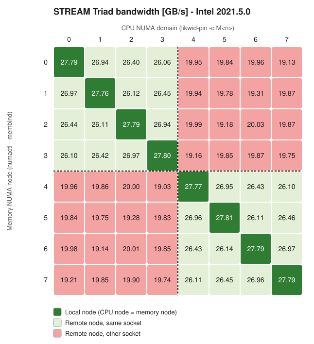

# NUMA effects on AMD Zen2 (EPYC 7702)

How much memory bandwidth do you lose when threads read memory that sits on a
different NUMA node? This repo measures it on a dual-socket **AMD EPYC 7702
(Zen2, "Rome")** node with the **STREAM Triad** benchmark, built with three
compilers: **AOCC**, **GCC** and **Intel**.

## Test system (CARO)

| | |
|---|---|
| CPU | 2 × AMD EPYC 7702, 64 cores per socket |
| NUMA layout | 4 NUMA domains per socket (NPS4) × 2 sockets = **8 NUMA domains per node** |
| Cores | 16 cores per NUMA domain × 8 NUMA domains = **128 cores per node** |
| Caches | L1 32 KB and L2 512 KB per core, L3 16 MB per CCX (4 cores) |
| Memory | 32 GB per NUMA node |

## Method

STREAM Triad (`a[i] = b[i] + q * c[i]`) is run once for every (CPU node, memory node)
pair, which gives 64 runs:

* threads pinned to NUMA domain **X**: 16 OpenMP threads, one per core of that domain
  (`likwid-pin -c MX:0-15`)
* arrays allocated on NUMA node **Y** (`numactl --membind=Y`)

Each cell in the matrices below is the Triad bandwidth for that pair.
`STREAM_ARRAY_SIZE=260000000` doubles means 3 × 2.08 GB ≈ 6.2 GB of data per run.
That is far larger than the caches, so the benchmark measures DRAM bandwidth.

## Results

How to read the matrices:
* **Rows**: the NUMA node the memory is on (`numactl --membind`, outer loop).
* **Columns**: the NUMA domain the threads run on (`likwid-pin -c M<n>`, inner loop).
* **Dashed lines**: the boundary between socket 0 (nodes 0-3) and socket 1 (nodes 4-7).

### AOCC 3.2.0


### GCC 10.3.0


### Intel 2021.5.0



### Averages per locality tier (GB/s)

| Compiler | Local | Same socket | Other socket | Loss, same socket | Loss, other socket | Node total (8 × local) |
|---|---|---|---|---|---|---|
| AOCC 3.2.0 | 39.34 | 37.32 | 25.52 | −5.1 % | −35.1 % | 314.7 |
| GCC 10.3.0 | 27.77 | 26.54 | 19.70 | −4.4 % | −29.0 % | 222.1 |
| Intel 2021.5.0 | 27.79 | 26.50 | 19.71 | −4.6 % | −29.1 % | 222.3 |

## Observations

1. **Bandwidth falls into three tiers.** Local memory is fastest. Memory on another
   node of the same socket costs about 5 %, because the traffic only crosses the
   on-package I/O die. Memory on the other socket costs 30-35 %, because every access
   also crosses the Infinity Fabric link between sockets.
2. **Within a tier, distance barely matters.** All remote nodes on the same socket
   give nearly the same bandwidth, and so do all nodes on the other socket. The die
   topology hardly shows. The step that counts is the socket boundary.
3. **AOCC is about 42 % faster than GCC and Intel** on local memory (39.3 vs 27.8 GB/s).
   The difference is `-fnt-store`: AOCC writes `a[]` with non-temporal (streaming)
   stores, which skip the read-for-ownership on each written cache line. Without
   them, Triad moves 4 streams of traffic instead of 3. That ratio is 4/3 ≈ 1.33, and
   prefetch effects add to it.
4. **GCC and Intel agree to within 0.1 GB/s.** The Intel build asks for
   `-qopt-streaming-stores always` but does not gain bandwidth from it, so the
   streaming stores most likely don't reach the generated code in this build.
5. **Practical takeaway:** on Zen2 nodes, pin threads and first-touch their memory
   on the same NUMA node, or at least on the same socket. One thread or rank layout
   that crosses sockets can cost a third of the memory bandwidth.

## Building STREAM with Spack

All three builds use STREAM 5.10 with OpenMP.

**AOCC 3.2.0**
```bash
spack -d install -v stream@5.10 +openmp %aocc@3.2.0 cflags="-mcmodel=large \
  -DSTREAM_TYPE=double -mavx2 -DSTREAM_ARRAY_SIZE=260000000 -DNTIMES=10 \
  -ffp-contract=fast -fnt-store"
```

**GCC 10.3.0**
```bash
spack -d install -v stream@5.10 +openmp %gcc@10.3.0 cflags="-Ofast -march=native -mtune=native \
  -mcmodel=large -DSTREAM_TYPE=double -mavx2 \
  -DSTREAM_ARRAY_SIZE=260000000 -DNTIMES=10 \
  -ffp-contract=fast"
```

**Intel 2021.5.0**
```bash
spack -d install -v stream@5.10 +openmp %intel@2021.5.0 cflags="-xhost -mcmodel=large \
  -DSTREAM_TYPE=double -mavx2 -DSTREAM_ARRAY_SIZE=260000000 -DNTIMES=10 -Ofast \
  -ffreestanding -ffp-contract=fast -qopt-streaming-stores always"
```

`-mcmodel=large` is required because the static arrays are larger than 2 GB.

## Running on a single node

The full 8 × 8 sweep runs on one node. `numactl` decides where the memory is
allocated, and `likwid-pin` decides which cores the threads run on:

```bash
for m in `seq 0 7`
do
    for c in `seq 0 7`
    do
        env OMP_NUM_THREADS=16 \
        numactl --membind=$m likwid-pin -c M${c}:0-15 stream_c.exe
    done
done
```

* `numactl --membind=$m`: every page of the STREAM arrays is allocated on NUMA node `m`.
  If that node runs out of memory, the allocation fails instead of falling back to
  another node.
* `likwid-pin -c M${c}:0-15`: pins the 16 OpenMP threads one-to-one to cores 0-15 of
  likwid's memory domain `M${c}`, which covers all 16 cores of NUMA node `c`.
* `OMP_NUM_THREADS=16`: one thread per core in the domain. SMT siblings are not used.
* `stream_c.exe`: the STREAM binary installed by Spack. Put it on your `PATH` with
  `spack load stream%<compiler>`.

Take the `Triad:` line from each run's output to fill the matrix.
`likwid-topology -g` shows how the `M0`-`M7` domains map to cores on your machine.

## Regenerating the figures

The raw matrices are stored in [`data/`](data) as 8×8 CSV files (rows = memory node,
columns = CPU domain). The heatmaps are drawn by a script that needs only the
Python standard library:

```bash
python3 scripts/plot_heatmap.py data/aocc.csv  images/aocc.svg  "AOCC 3.2.0"
python3 scripts/plot_heatmap.py data/gcc.csv   images/gcc.svg   "GCC 10.3.0"
python3 scripts/plot_heatmap.py data/intel.csv images/intel.svg "Intel 2021.5.0"
```
